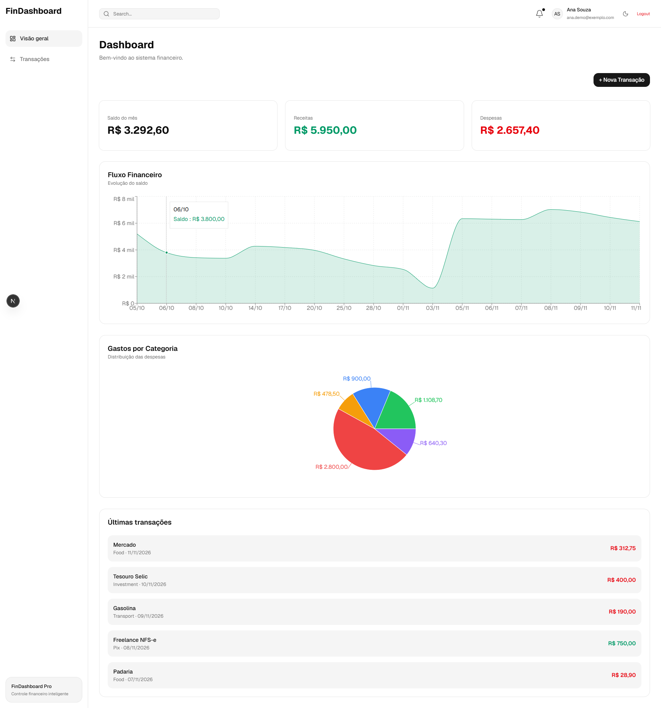
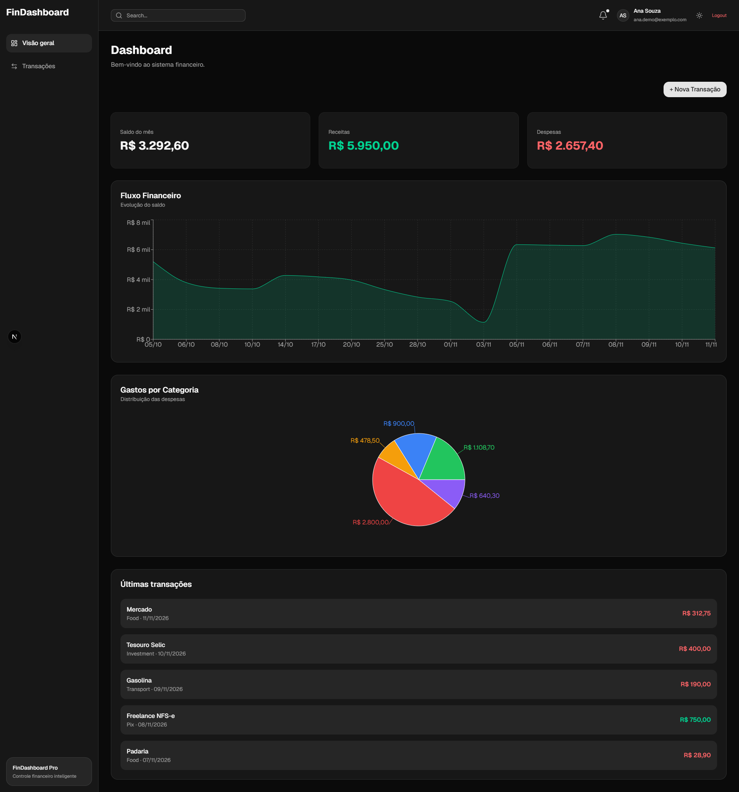
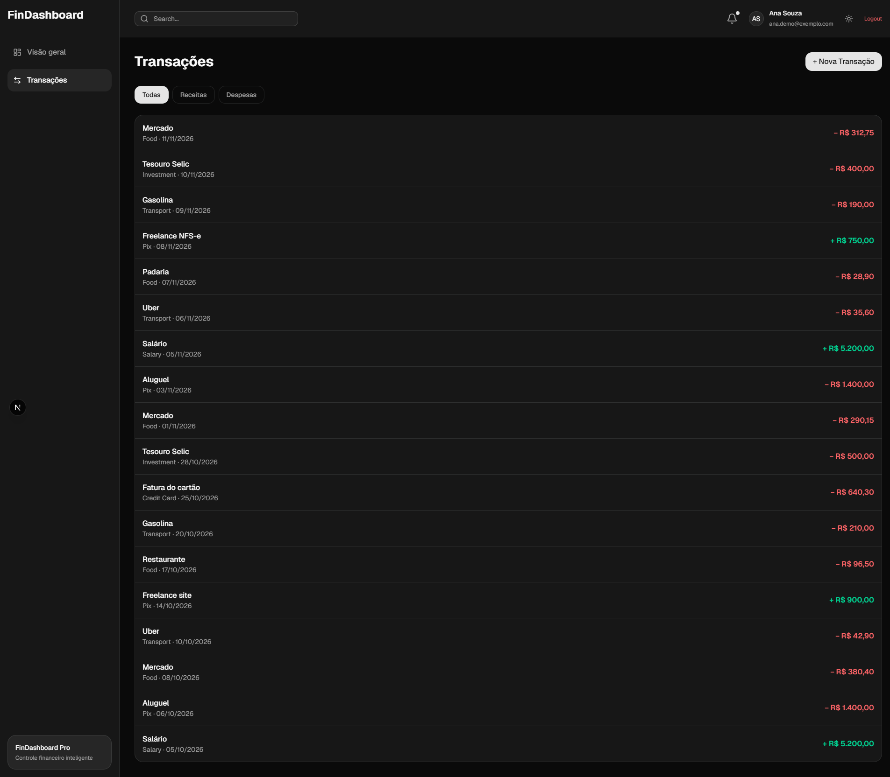

# Dashboard Financeiro

Aplicação fullstack de **controle financeiro pessoal**: o usuário faz login e registra receitas e despesas por categoria. O painel mostra o saldo do mês, os gráficos e a lista de transações, com tema claro e escuro.

> Projeto criado para estudar **NestJS**, **Prisma** e **Next.js**, com foco em **segurança**, **validação** e **testes**. Veja o roadmap no fim do README.

## Telas

| Tema claro | Tema escuro |
|---|---|
|  |  |



## Funcionalidades

- **Cadastro e login** com senha criptografada (**bcrypt**) e autenticação via **JWT**
- **Rotas protegidas** no backend (`AuthGuard('jwt')`): cada usuário só vê as próprias transações
- **Visão geral** com o saldo, as receitas e as despesas **do mês atual**, gráfico de evolução do saldo e gráfico de gastos por categoria
- **Página de transações** com a lista completa e filtro por tipo (todas, receitas ou despesas)
- **Nova transação** por um modal, nas duas páginas
- Valores em **reais** (`R$ 1.234,50`) e datas no formato brasileiro
- **Tema claro e escuro** com as cores do tema do shadcn/ui, e layout responsivo com menu lateral

## Segurança e qualidade

- **Segredos fora do código:** o segredo do JWT fica no `.env` (`@nestjs/config`). Sem ele, a API **não sobe** (`getOrThrow`)
- **Validação de todas as entradas** com DTOs, `class-validator` e `ValidationPipe` global
  - `whitelist` + `forbidNonWhitelisted`: campos que não estão no DTO são **recusados** (proteção contra *mass assignment*)
  - Exemplos: e-mail válido, senha com 6+ caracteres, valor positivo com até 2 casas decimais e tipo só `income` ou `expense`
- **A senha nunca sai da API:** o cadastro e o `/users/me` usam `select` do Prisma para devolver só `id`, `name` e `email`
- **Testes automatizados** com Jest: services com mocks do Prisma (escritos em TDD) e testes das regras dos DTOs
- **Tipagem estrita:** nenhum `any` no projeto. ESLint e `tsc` sem erros no backend e no frontend
- **Prettier** nos dois lados (no frontend, com o plugin que ordena as classes do Tailwind)

## Tecnologias

| Camada | Tecnologias |
|---|---|
| Backend | Node.js, **NestJS 11**, TypeScript, Passport + JWT, bcrypt, class-validator, @nestjs/config |
| Banco de dados | **PostgreSQL** + **Prisma ORM** (com migrations) |
| Frontend | **Next.js 16** (App Router), React 19, TypeScript, Tailwind CSS 4, shadcn/ui, Recharts, Axios |
| Qualidade | Jest, ESLint, Prettier |

## Estrutura

```
dashboard-financeiro/
├── backend/                       # API NestJS
│   ├── prisma/                    # schema.prisma e migrations
│   └── src/
│       ├── auth/                  # cadastro, login, estratégia JWT e DTOs
│       ├── users/                 # /users/me
│       ├── transactions/          # transações (rotas protegidas) e DTO
│       └── prisma/                # PrismaService
└── frontend/                      # Next.js (App Router)
    └── src/
        ├── app/
        │   ├── login/             # tela de login
        │   └── (painel)/          # layout com menu lateral e topo
        │       ├── page.tsx       # visão geral
        │       └── transacoes/    # lista com filtro
        ├── components/            # gráficos, cards, modal e layout
        ├── hooks/                 # useAuth e useTransacoes
        ├── lib/format.ts          # formatação de moeda e data
        ├── types/                 # tipos compartilhados
        └── services/api.ts        # Axios + interceptor que envia o Bearer token
```

## Modelo de dados

```prisma
model User {
  id           String        @id @default(uuid())
  name         String
  email        String        @unique
  password     String
  transactions Transaction[]
}

model Transaction {
  id       String @id @default(uuid())
  title    String
  amount   Float
  type     String   // "income" | "expense"
  category String   @default("Other")
  userId   String
}
```

## Endpoints

| Método | Rota | Autenticação | Descrição |
|---|---|---|---|
| POST | `/auth/register` | — | Cria um usuário (nome, e-mail válido e senha com 6+ caracteres) |
| POST | `/auth/login` | — | Retorna o `access_token` (JWT) |
| GET | `/users/me` | JWT | Dados do usuário logado (sem a senha) |
| GET | `/transactions` | JWT | Lista as transações do usuário |
| POST | `/transactions` | JWT | Cria uma transação (validada) |

Dados inválidos recebem **400 Bad Request** com a lista de erros, por exemplo:

```json
{
  "message": ["email must be an email", "password must be longer than or equal to 6 characters"],
  "error": "Bad Request",
  "statusCode": 400
}
```

## Como rodar localmente

**Pré-requisitos:** Node.js 20+ e PostgreSQL.

### Backend (porta 3001)

```bash
cd backend
npm install
cp .env.example .env              # ajuste a DATABASE_URL e o JWT_SECRET
npx prisma migrate dev            # cria as tabelas
npm run start:dev
```

Para gerar um `JWT_SECRET` forte:

```bash
node -e "console.log(require('crypto').randomBytes(32).toString('hex'))"
```

### Frontend (porta 3000)

```bash
cd frontend
npm install
npm run dev
```

Crie um usuário pela API (a tela de cadastro ainda não existe no frontend):

```bash
curl -X POST http://localhost:3001/auth/register \
  -H "Content-Type: application/json" \
  -d '{"name":"Teste","email":"teste@exemplo.com","password":"123456"}'
```

No PowerShell (Windows):

```powershell
Invoke-RestMethod -Method Post -Uri http://localhost:3001/auth/register -ContentType "application/json" -Body '{"name":"Teste","email":"teste@exemplo.com","password":"123456"}'
```

Depois acesse `http://localhost:3000` e faça login.

### Testes e checagens

```bash
cd backend
npm test            # testes com Jest
npx eslint src      # lint
npx tsc --noEmit    # tipos
```

## Roadmap

- [x] Mover o segredo do JWT para variável de ambiente
- [x] Validar as entradas com `class-validator` e `ValidationPipe`
- [x] Não retornar o hash da senha na resposta do cadastro
- [x] Calcular os cards a partir dos dados reais
- [x] Testes unitários dos services (`AuthService` e `UsersService`) e dos DTOs
- [x] Tema claro corrigido, página de transações e navegação pelo menu lateral
- [ ] Trocar `amount` de `Float` para `Decimal` (valores monetários)
- [ ] Tela de cadastro no frontend
- [ ] Editar e excluir transações
- [ ] Categorias em português na tela
- [ ] Testes e2e e GitHub Actions rodando os testes a cada push
- [ ] Docker Compose e deploy

---

Desenvolvido por **Anderson Galvão** · [LinkedIn](https://www.linkedin.com/in/aqgalvaojr/)
